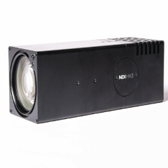
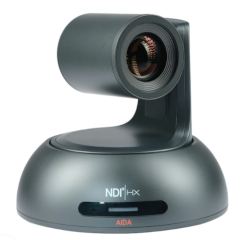
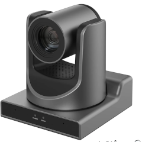
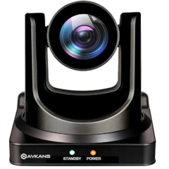
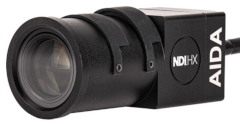

# Camera Testing Results

This page records the network cameras that have been tested with CrewTimer Video Recorder. For the recommended camera and a full equipment list, see [Recommended Video Equipment](./VideoEquipment.md).

Most NDI or SRT cameras should work with CrewTimer Video Recorder. However, some low-end cameras have unreliable frame timing. We tested each camera below by recording 1080P at 60 fps or more and checking the Event Log for frame gaps and timestamp problems.

Found a camera that works well for you? Please email [CrewTimer](mailto:info@crewtimer.com) so it can be added to the list.

## Tested Cameras

| Price | Zoom | Pan/Tilt | Res | FPS |  | Result | Model |
| ----- | ---- | -------- | --- | --- | - | ------ | ----- |
| $1075 | 30X | No | 4K | 60 |  | **Recommended** | [AIDA UHD-NDI3-X30](https://a.co/d/1T1P2zE) |
| $1450 | 20X | Yes | 4K | 120 |  | Works | [AIDA PTZ-NDI3-X20](https://usbroadcast.co/product/aida-imaging-ptz-ndi3-x20b-full-hd-ndihx2-ptz-camera-20x-zoom-black/) |
| $719 | 30X | Yes | 1080P | 60 |  | Works (firmware update needed) | [SMTAV BX30N](https://www.smtav.com/collections/ndi/products/smtav-ai-tracking-ndi-ptz-camera-30x-optics-zoom) |
| $799 | 30X | Yes | 1080P | 60 |  | Works | [AVKANS NDI PTZ Camera](https://a.co/d/acMZ1qf) |
| $475 | 8x (manual) | No | 1080P | 60 |  | **Not recommended.** Drops random frames. | AIDA HD-NDI-TF |
| — | — | Yes | — | — | | **Not recommended.** Unreliable NDI timestamps. | SMTAV BA series |

Prices are approximate as of the time of testing.

## Notes from Testing

* **Update the firmware first.** Cameras often need software updates to work properly. Update a camera as soon as you buy it.
* **SMTAV BX30N:** Needs firmware version 8.02.88 or later for DHCP to work properly. Contact <info@smtav.com> for firmware updates. They also have a .pkg update that fixes a Chrome browser issue in version 8.02.88.
* **SMTAV BA series:** NDI timestamps were unreliable.
* **AIDA HD-NDI-TF:** Dropped random frames during recording.
* **Resolution:** 1080P gives a good balance of image quality, computer load, and file size. A 4K recording uses about 4x the space of 1080P and needs a top-end computer. A 4K camera can still be set to output 1080P.
