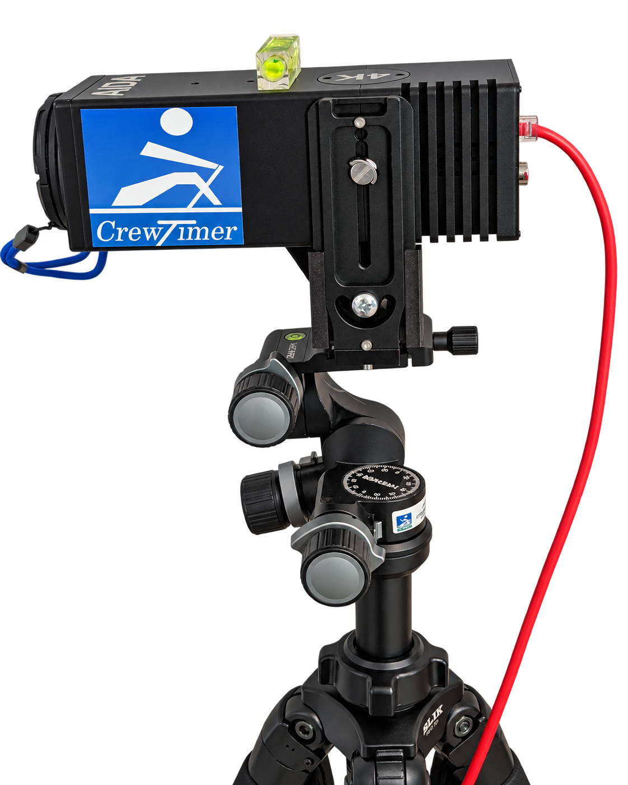

# Recommended Video Equipment

This is the recommended equipment for a finish-line video system using CrewTimer Video Recorder and Video Review. It is built around the **AIDA UHD-NDI3-X30** camera, which has proven reliable in our testing. For other cameras that have been tested, see [Camera Testing Results](./CameraTesting.md).

CrewTimer does not resell any of these items. You are free to buy equipment from your preferred source. Prices are approximate.

*AIDA UHD-NDI3-X30 mounted at 90 degrees with an L bracket on a three-way geared tripod head.*

## Camera

| Item | Price | Notes |
| ---- | ----- | ----- |
| [AIDA UHD-NDI3-X30](https://www.bhphotovideo.com/c/product/1776614-REG/aida_imaging_uhd_ndi3_x30_uhd_4k_60_ndihx3_ip_srt_hdmi_poe.html) | ~$1230 | 30x zoom NDI/SRT camera powered over Ethernet (PoE). Set it to 1080P at 60 fps. Update the firmware when you receive it. Sometimes you can get a [refurbished unit at 50% discount](https://www.aidaimaging.shop/products/uhd-ndi3-x30-refurbished) from the manufacturer. |

## Mounting

| Item | Price | Notes |
| ---- | ----- | ----- |
| [NEEWER Tripod Head](https://amzn.to/4cq5cpn) | ~$159 | Three-way geared head for fine level, tilt, and pan adjustment. |
| [Camera L Bracket](https://a.co/d/00L4ildj) | | Mounts the camera at 90 degrees for portrait recording. |
| [3D-printed L-bracket shim](./assets/L-Bracket-Shim-v13.stl) | | Printable shim that fits the camera securely to the L bracket. Most cameras in this price range are rolling shutter top to bottom which can skew the finish line time based on y axis position.  While a correction is in place for AIDA UHD-NDI3-X30, it is recommended to mount the cameras rorated 90 degress so any vertical slice is the same instant. |
| [3D-printed AIDA rain shield](./assets/Aida-Rain-Cover-Rotated-v10.stl) | | Printable rain cover for the rotated camera. Attach it with a [1/4-20 camera screw](https://a.co/d/06aEvW0P). |
| [SLIK Pro 700 DX Tripod](https://a.co/d/09MtQcZa) | ~$140 | Sturdy portable tripod. |
| [SLIK Pro CF-734 Tripod](https://amzn.to/4cuixxg) | | Carbon fiber alternative that fits in carry-on luggage. |
| [Manfrotto Super Clamp](https://amzn.to/4bNIYO1) | ~$37 | Optional. For mounting on scaffolding or railings instead of a tripod. |
| [Focusing Rail](https://amzn.to/3wIi37i) | | Optional. Allows fine side-to-side camera movement for alignment with a guide wire. |

A vertical rod on top of the camera is also useful. It acts as a sight line for camera alignment and for timers stationed behind the camera. See [Geek Level Camera Alignment](./CameraAlignment.md).

## Networking

The camera is powered by the PoE switch and connects to the laptop over the same switch. **The camera must be wired. WiFi will drop video frames.**

| Item | Price | Notes |
| ---- | ----- | ----- |
| [STEAMEMO 5 Port PoE Gigabit Switch](https://a.co/d/09k3RlfS) | ~$29 | Powers the camera over the network cable. |
| [LTE Router](https://amzn.to/3QMPTP9) or [Gl.iNet](https://a.co/d/0gdl5KJI)| | Provides Internet and DHCP when no wired Internet is available. |
| Ethernet cables (Cat5e/Cat6) | | One from the switch to the camera, one to the laptop, and one to the Internet source. Bring spares and enough length to reach the camera position. |
| USB-C Ethernet adapter or dock | | For laptops without an Ethernet port. Use the laptop's fastest USB port. |

**Internet access:** The camera needs Internet to synchronize its clock if the video will be used for backup timing. Connect the switch to a facility network drop, an LTE router, or a laptop using [Internet Connection Sharing](./VideoRecorder.md#internet-connection-sharing). **Test the Internet connection and camera before regatta day.**

## Computer and Storage

| Item | Price | Notes |
| ---- | ----- | ----- |
| Laptop | | MacBook Air M-series, Macbook Pro M-series, or a mid-range or better **Intel** windows laptop.  For Windows an nvidia gpu works well but Intel gpus are known to work as well.  |
| [1 or 2TB Portable SSD](https://amzn.to/3Rvhghm) | ~$171 | Video storage. 1TB is enough for a multi day regatta. |
| Network and USB Dongle || The [Anker USBC 6-in-1](https://a.co/d/0i9XZ8Of) works well. Plug the SSD into it's high speed port. |
| Second monitor | | Optional. Useful for video review. |

## Power

| Item | Price | Notes |
| ---- | ----- | ----- |
| [EcoFlow River 2](https://a.co/d/asskFah) | | Portable power station when no AC power is available. Can run the switch, router, and laptop. |
| [Micro USB PoE+ splitter](https://amzn.to/3QSqzHw) | | Optional. Powers a micro-USB device (such as a router) from the PoE switch. |
| [USB-C PoE+ splitter](https://amzn.to/3QU2Vup) | | Optional. Powers a USB-C device (such as a router) from the PoE switch. |

## Next Steps

* [Example Video Setup and Configuration](./VideoSetup.md) shows how to connect all of this equipment.
* [CrewTimer Video Recorder](./VideoRecorder.md) covers camera settings and recording.
* Optional [Geek Level Camera Alignment](./CameraAlignment.md) explains how to line the camera up on the finish line.
