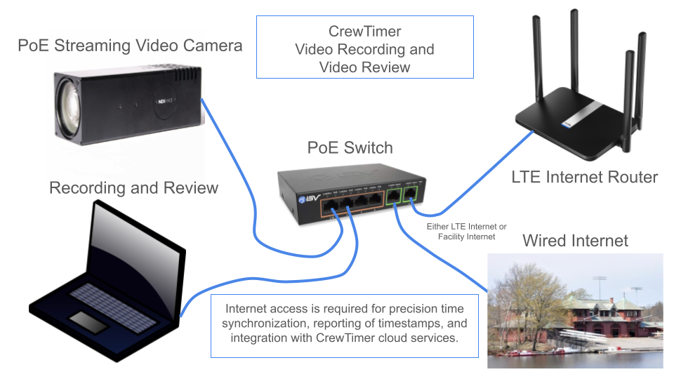

# CrewTimer Video Recorder

The CrewTimer Video Recorder app records timestamped MP4 video for use with the CrewTimer Video Review app. It accepts NDI and SRT network video, provides a live preview and camera controls, and records the crop, orientation, finish-line position, and timing metadata needed during review.

Watch the [CrewTimer Video Recorder training videos](https://www.youtube.com/playlist?list=PLSIPH6-6DDtDjL5tFoddhv9D5MfUjvS0b) for setup and operating demonstrations.



- [CrewTimer Video Recorder](#crewtimer-video-recorder)
  - [Requirements](#requirements)
  - [Installation](#installation)
  - [Quickstart](#quickstart)
  - [Recorder controls and output](#recorder-controls-and-output)
    - [Recording settings](#recording-settings)
    - [Preview and diagnostics](#preview-and-diagnostics)
    - [Recorded files and timing metadata](#recorded-files-and-timing-metadata)
  - [Example setup](#example-setup)
  - [Customize and adjust your camera settings](#customize-and-adjust-your-camera-settings)
  - [Camera Settings](#camera-settings)
    - [Camera Exposure](#camera-exposure)
    - [Adjusting Finish Line guide](#adjusting-finish-line-guide)
    - [Cropping Video](#cropping-video)
    - [Focus Assist](#focus-assist)
    - [Camera Alignment](#camera-alignment)
  - [Internet Connectivity](#internet-connectivity)
    - [Hardwired Internet available](#hardwired-internet-available)
    - [Only WiFi available](#only-wifi-available)
  - [Camera Selection](#camera-selection)
  - [Software Tools](#software-tools)
  - [Internet Connection Sharing](#internet-connection-sharing)
  - [Setting network priority](#setting-network-priority)
    - [MacOS](#macos)
    - [Windows](#windows)


## Requirements

* An SRT or [NDI](https://en.wikipedia.org/wiki/Network_Device_Interface)-capable network video camera. NDI provides low-latency video over a 100 Mbit or Gigabit network; SRT (Secure Reliable Transport) is also supported as an input protocol.
* **A hardwired network connection between the recording computer and camera.** WiFi can drop video frames due to RF interference.
* Internet access, either hardwired or via a hotspot, when video timestamps will be used for backup timing. SRT and NDI cameras commonly synchronize with Network Time Protocol (NTP) servers before timestamping frames. If the video will only be used to determine finish order, Internet access is not required.
* MacOS or Windows laptop.  Generally any laptop produced after 2020 is suitable.  The least expensive laptop from Costco works.

## Installation

Download the installer from the [Downloads Page](https://crewtimer.com/help/Downloads).

## Quickstart

1. Connect your camera to a network switch also connected to your recording computer.
2. Start the CrewTimer Video Recorder app.
3. Select **SRT** or **NDI** in the Protocol field, then select the camera or stream from the Camera dropdown. The dropdown displays the source IP address when available. **SRT** is preferred.
4. Review the recording folder, filename prefix, recording slice duration, and waypoint. Select **Any** for the waypoint unless this recorder should respond only to split commands for a particular course location.
5. Verify the live preview. Adjust rotation, crop, and finish-line position before recording.
6. Press **Start** in the top bar. While recording, the top bar displays elapsed time, current filename, input resolution, cropped resolution, frame rate, and encoder backlog. Click the red recording status to stop.

> Note: The camera must be connected with a wired ethernet interface.  Using WiFi will result in dropped video frames.

On macOS, if no cameras appear, allow CrewTimer Video Recorder access under **System Settings → Privacy & Security → Local Network**. The recorder also displays a shortcut to this setting when discovery is blocked.

## Recorder controls and output

### Recording settings

The Settings page provides these controls:

* **Camera and Protocol** - Select an automatically discovered NDI or SRT source. A missing previously selected source is shown in red.
* **VISCA Port** - Enable in-app camera control by selecting the TCP port used by the camera. Select port 0 if the camera does not support VISCA. The camera icon opens the selected camera's web interface.
* **Recording Folder and Filename Prefix** - Choose where clips are saved and the prefix added to every filename. The adjacent folder button opens the selected location in Finder or File Explorer.
* **Recording Slice (sec)** - Set the target duration of each MP4 clip. Recording continues across slice boundaries, producing manageable consecutive files rather than one very large file.
* **Waypoint** - Bind a recorder to a CrewTimer Video Review waypoint such as Start or Finish. **Any** accepts split commands for every waypoint, which is useful when only one recorder is running.
* **Finish Line** - Show or hide the finish-line guide in the preview. Its saved position is used by Video Review.
* **Live Preview** - Keep the selected source preview active whenever it is available, including while navigating between Settings, Video, and Event Log pages.

Settings are retained between app launches. Changes to the camera, protocol, rotation, slice duration, or filename prefix apply when recording is restarted. Changing the crop while recording automatically restarts the recording after a short delay.

### Preview and diagnostics

The Settings preview and the larger Video page provide the same framing tools:

* Drag the crop handles to select the recorded region. Use the crop icon to enter or leave crop adjustment, and use the view icon to switch between the whole source and a preview fitted to the cropped area.
* Right-click the preview to cycle through whole-frame, cropped, and 6x inspection views. Drag while zoomed to inspect another part of the image.
* Select 0°, +90°, -90°, or 180° rotation. Rotation supports landscape, portrait, and inverted camera mounting and resets the crop and finish guide.
* Drag the finish-line guide. Hold **Shift** while dragging to move only one end and set an angled line; use the center-line icon to reset it.
* Enable **Focus Assist** to display a movable measurement region and focus score. A higher score indicates a sharper image for the selected region.
* When VISCA is enabled, the Video page can control focus, one-shot autofocus, zoom, exposure mode, iris, shutter, gain, and brightness. Five recorder-side presets can save and restore supported camera settings.
* An exposure warning appears when the connected camera is not using Manual or Shutter Priority mode at 1/500 second or faster.

The Event Log reports source, timing, and recording events, including detected frame gaps. An initial gap while a stream starts or settings change is normal. Repeated gaps over about 90 ms indicate that the network, camera, or computer cannot sustain the selected stream; try cropping, lowering resolution, or checking the wired network. A growing encoder backlog in the top bar is another indication that the computer is not keeping up.

### Recorded files and timing metadata

Each recording slice produces an MP4 file and a JSON sidecar file with the same base name. The sidecar records image dimensions, the crop within the original source, source rotation, finish-line geometry, and available sensor/rolling-shutter timing information. Keep the MP4 and JSON files together when copying recordings to another computer or loading them into Video Review.

The recorder uses hardware-accelerated video decoding and encoding where supported. Frame timestamps are also embedded in the recorded output so Video Review can correlate video with race timing. For accurate backup timing, synchronize the camera with NTP and confirm its clock before the event.

## Example setup

See [Example Video Setup and Configuration](./VideoSetup.md) for a complete sample laptop, camera, network, and alignment setup.

## Customize and adjust your camera settings

For compatible cameras, focus, zoom, exposure, and presets can be adjusted from the **Video** side-navigation tab. These controls use VISCA over IP. Select the VISCA port on the Settings page; it must match the port configured by the camera vendor.

If your camera does not have VISCA support, use 0 for the VISCA port.  You can also click on the Camera icon to directly open the web page of the camera.

1. Connect to your camera with a web browser. e.g. <http://10.0.1.188> and log in.  Cameras often default to 'admin' as the username and 'admin' as password.
2. Configure your camera to 1080p (1920x1080@60) video.  Use 60 fps or higher rate for the video stream.  This is often a choice under a configuration menu on the web interface.  Use of 4K is not recommended due to 4x higher cpu load and file size without a significant benefit.
3. Confirm that **Live Preview** is selected and review the video preview. Press **Start** in the top bar when you are ready to record.
4. Review the event log. Look for reported gaps in the recording.  It is normal to have an initial gap reported as the video is starting or properties are changed.  If you see gaps > 90ms you may need to get a faster computer, reduce the resolution, or use the crop function to reduce resolution.

## Camera Settings
### Camera Exposure

The key setting in the camera for useful video is are the exposure controls.  While 'auto' exposure can provide good results you lose control over key aspects such as shutter speed.  The following is recommended for use capturing video:

1. Choose a shutter speed of 1/1000 and aperature Fstop of f5.6
2. If the image is too light, reduce the aperature by increaseing the Fstop number has high as possible.  Choose an aperature of f5.6 or greater if possible.  A higher Fstop increases the size of the area that will be in focus.
3. If the image is still too light at max Fstop, increase the shutter speed to get the desired light level.
4. If the image is too dark at 1/1000 and f5.6, try increasing Gain before lowering shutter speed and Fstop.

### Adjusting Finish Line guide

A red line is drawn on the video to show the location of the finish line.  The position chosen is utilized by the Video Review app to help score the finish times for boats.  To adjust the finish line position:

* Drag the top handle to adjust the position.  When the top handle is moved, the bottom handle moves with it.
* Drag the bottom handle to adjust only the bottom position.  This allows selecting a finish line that has a orientation other than exactly vertical.  However, it is better to properly align the camera than to adjust the angle digitally.
* Press the 'move to center' icon to reset the guide to the center of the video.

### Cropping Video

Recorded video can be cropped to eliminate areas that do not provide useful context, decrease file size, and provide a snappier review process.  This results in smaller mp4 files as well as reducing overhead needed to encode the video.  If the log reports gaps, cropping the recorded video can eliminate the gaps by reducing the cpu overhead required to record.

* Utilize the drag handles in the corners of the video to adjust cropping.
* Maximize icon - Press the maximize icon to set the cropping rectangle to maximum size.

### Focus Assist

When the **Focus Assist** checkbox is checked, a small rectangle will show up over the video and a focus score will be computed for the region within the rectangle.  As you adjust focus a higher number represents better focus.  This works best if you have a stationary object such as a boat or buoy in the image.

Try focusing at a point 1/3 across the timing zone.  Generally the area in focus will be 2/3 beyond the focus point and 1/3 before the focus point.

### Camera Alignment

If your recording includes the far line marker and you do not need to change zoom settings you can simply use the adjustment in the recorder app to set 'Finish Line'.  However, you need to change the camera angle or zoom
differently than for production recording you will need to refine your camera mount a bit more so when you zoom you know you haven't moved off your finsih line.

See the [Geek Level Camera Alignment](./CameraAlignment.md) document for a detailed walkthrough to get ultimate alignment.

## Internet Connectivity

NDI cameras have a NTP client built-in which sets the camera time from a network time server.  The camera then timestamps each video frame allowing applications to synchronize multiple video streams gathered separately.  For use with CrewTimer, these timestamps are used to accuratly timestamp each frame in the CrewTimer Connect app.  If internet connectivity is not present, the camera will timestamp video based on it's current notion of time.

If the only use for the video is for finish order determination, Internet connectivity is not required.  However, if the intent is to utilize the video as backup timing in additon to quickly determining finish order, an Internet connection is required.

**NOTE: Do not try to set up your Internet on regatta day for the first time.** You should test out your connectivity ahead of time and understand how your network needs to be configured.

### Hardwired Internet available

If local hardwired internet is available, simply ensure the camera network connection has access to the network.  Hardwired Internet can be from a facility LAN drop or it could be from a hotspot with RJ45 cabled network connections.  The recording computer should preferably be on the same network switch as the camera.  See [Recommended Video Equipment](./VideoEquipment.md#networking) for an example LTE router.

### Only WiFi available

If only WiFi is available, there are several configurations which can work in this situation.

1. Use a WiFi router in client mode to connect to the available WiFi.  The network ports on the WiFi router would the connect to the camera and laptop.  Many WiFi routers support this type of connectivity.  In this scenario the WiFi in the laptop should be disabled or the WiFi should be set as the preferred Internet port (see instructions below).
2. Utilize Windows Internet Connection Sharing (ICS) or MacOS Connection Sharing to share the WiFi connection with the computer wired interface.  In this scenario, connect a switch to the computer and also the camera.  The camera will obtain an IP address from the computer's ICS software and access the internet via it's WiFi connection.
3. Optional - Add your own NTP server on the camera network using a Raspberry Pi.  Use fixed IP addresses on the wired network with the camera NTP server configured to utilize your local NTP server.  The laptop will also be configured with a fixed IP address on the wired network so it can communicate with the camera and record video.  WiFi should be set as the preferred Internet port (see instructions below).

## Camera Selection

See [Recommended Video Equipment](./VideoEquipment.md) for the recommended camera, mounting, networking, and power equipment.

Most NDI or SRT capable cameras should work with CrewTimer Video Recorder, but some low-end cameras provide unreliable frame timing. See [Camera Testing Results](./CameraTesting.md) for the cameras that have been tested and which ones to avoid.

## Software Tools

NDI Tools are available to help monitor test NDI video streams.  The following programs are recommended and are part of the FREE [NDI Tools](https://ndi.video/tools/) download.  Registration is required.

* [NDI Video Monitor](https://ndi.video/tools/ndi-video-monitor/) - Watch the video stream from the camera from any other device.  Display on a large monitor if desired.
* [NDI Scan Converter](https://ndi.video/tools/ndi-scan-converter/) - Play a youtube video of a regatta, capture the video with NDI Scan Converter as an NDI stream and record it with CrewTimer Recorder to test it out.
* [NDI Test Patterns](https://ndi.video/tools/ndi-test-patterns/) - No camera yet?  Generate your own video stream with test patterns.

## Internet Connection Sharing

In liu of a LTE Router or wired internet connection is it possible to leverage an internet connection from a laptop. 

Both Mac and PC based laptops come with a feature called "Internet Connection Sharing" which allows the laptop internet connection to be shared with a local wired network connected to the camera.

To enable internet connection sharing (ICS) on a Windows computer, you can do the following:

1. Open the Power User menu by pressing Windows key + X 
2. Select Network Connections, then Click Change adapter options 
3. Right-click the network adapter you want to use (WiFi),Click Properties, Click Sharing 
4. Check the Allow other network users to connect through this computer's Internet connection checkbox, Click OK 

To enable internet connection sharing on a Mac:

1. Go to the Apple menu, select "System Settings", then navigate to "General" in the sidebar
2. Click "Sharing"; from there, check the "Internet Sharing" box
3. Choose the WiFi internet connection you want to share from the "Share your connection from" menu

## Setting network priority

**Note: This option is only used when you have a local NTP server (e.g. Raspberry Pi) on the wired network without Internet connection.**

When computers have both a wired connection and a WiFi connection, they will typically prioritize traffic to the wired connection.  If the wired network does not have Internet connectivity, it can cause the appearance no Internet capability because it tries to use the hardwired connection instead of WiFi.   This priority selection can be modified so that WiFi is utilized for Internet access in preference to a wired connection.When using laptops with a local network for cameras and a WiFi network for Internet the computer must be configured so the default route is via WiFi.

### MacOS

Go to Network Settings where it shows both the wired and wireless network on the same page.  At the very bottom of the page is a tiny dropdown where you can 'Set Service Order'.  Drag the WiFi connection to be above the wired connection.

### Windows

* Option 1 - Gui

```txt
Network & Internet ->Advanced -> More Network Adapter Options
Select WiFi Properties -> IPV4 -> Properties -> Advanced
Set Interface Metric to 10
```

* Option 2 - Command Line:

Windows-X and select ‘Terminal (Admin)’

```bash
Get-NetIPInterface and note the ifIndex of WiFi.  e.g. 20
Set-NetIPInterface -InterfaceIndex 20 -InterfaceMetric 10
```
